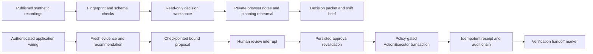

# AxonFDE: decisions that survive review

## The problem

A plausible explanation is insufficient when an intervention changes a shipment. The system has to distinguish evidence from a model narrative, bind approval to the exact proposed action, preserve the decision through a human wait, and inspect the outcome after execution.

The public decision workspace lets a reviewer inspect that process without pretending to operate a real fleet. Its two studies use already published synthetic recordings. The compressor recording ends in failed verification and a reopened incident: the original trajectory did not model a reroute. That negative result remains visible and exportable.

## Two separate execution paths

The website does not invoke the lower path. It grants no approval and dispatches no action. A rehearsal review belongs to one study, evidence fingerprint and set of assumptions; changes invalidate it. Notes remain in this browser and can be included in a portable export.

## Backend continuation contract

`ReviewGate.prepare` stores a bound proposal before `ReviewGate.wait` interrupts. The trusted application must provide an authenticated principal and fresh context loaders. A resume body identifies an approval; it cannot create one. `resume_review` also checks the authorized incident and the saved waiting node. The gate reloads current evidence and persisted approval before continuation and again before execution. Human waiting is removed from compute wall time without resetting step, token or tool counters.

`DatabaseReviewRuntime` delegates effects to the existing ActionExecutor rather than introducing a second authorization policy. The executor retains role checks, approval binding, locking and approval-derived idempotency. The adapter commits refusal audits before raising an error. A retry after an effect commits must resolve through the execution ledger; an expired or stale checkpoint is not evidence that no prior effect occurred.

The graph's final `verify` node opens the verification handoff; it is not a completed outcome evaluation. The separate verifier must evaluate later observations and persist the result. An actual deployment still needs authenticated application wiring, a persistent saver and operational reconciliation. The default historical cassette graph remains advisory. Neither the public recording nor the new library adapter is a claim of a deployed fleet service.

## Evaluation that can reject this implementation

- A versioned trajectory contract grades real graph runs and adversarial omissions, repetitions, reorderings and continuation after escalation. This checks order, not authorization or physical truth.
- Durable-review tests interrupt before effects, reconstruct the graph, reject untrusted resume values, and preserve compute accounting across a long human wait.
- Disposable-database CI checks saver reconnection, a committed effect retried after adapter reconstruction, and persistence of an authorization refusal audit.
- Forty-eight browser planning fixtures are recomputed by the actual Python cost engine. The probability and cost parameters remain assumptions, not calibrated savings.
- Browser CI checks mobile layouts, original replay behavior, citations, exports, storage failures, invalidated reviews, literal rendering of untrusted source text, and fail-closed evidence handling. Screenshots need human inspection before release.
- A separate production browser gate checks the deployed Git tree against the approved source tree. Historical evidence IDs remain unchanged; current website identity is an additional receipt.

## What a reviewer should try

1. Open the decision workspace from the existing project homepage.
2. Ask why approval was blocked, then follow the citation to the original step.
3. Ask whether the action worked. Inspect the failed result instead of a fabricated success.
4. Change cargo value or facility availability in the planning rehearsal. Mark assumptions reviewed, change one input, and observe that review is invalidated.
5. Compare a lying sensor case before and after repair. Inspect increased abstention and missed recoveries alongside reduced false confirmations.
6. Add a note and export the decision packet or shift brief. Inspect the scope, assumptions and source fingerprints.

## Limits and rejected embellishments

The verifier's frozen 24-case pack is not field accuracy. Nonconstant lying sensors remain unresolved, and honest constant sensors can incur abstention. Source hashes establish consistency, not authenticity. The recorded-question helper is deterministic lookup, not a newly benchmarked RAG agent. Browser notes are not persistent cross-device agent memory. MCP, voice, multi-agent swarms and paid inference were not added without a consumer or measurable need. The full fifteen-idea implementation/deferral ledger is in `fifteen-idea-decisions.md`.
